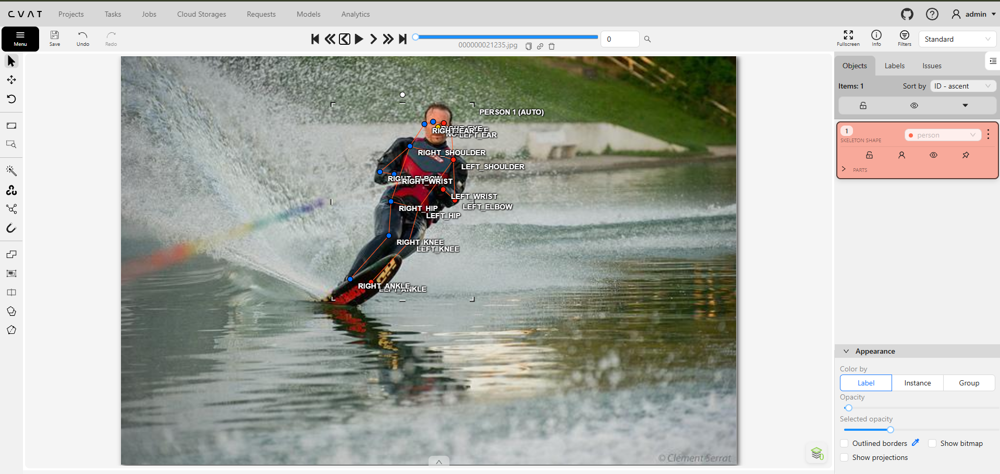
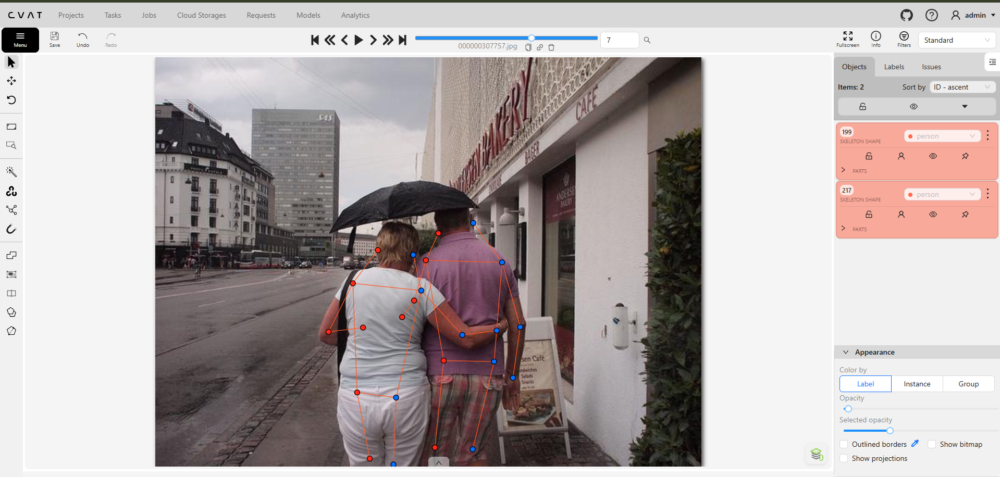
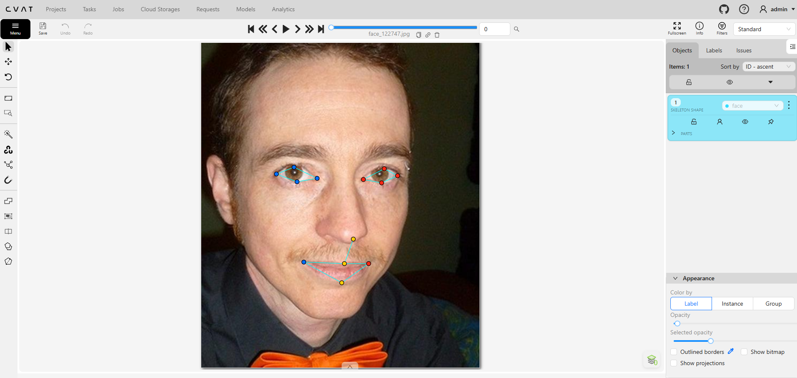
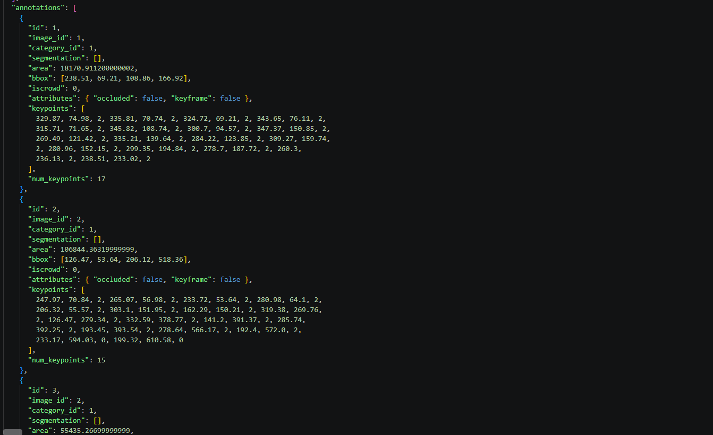

# Báo cáo cá nhân — PhamDucViet-2A202603265

Đổi tên file theo quy tắc `MSSV_HoTen.md`. Ví dụ: `20241234_NguyenVanAn.md`.

Dữ liệu: 12 ảnh người COCO 2017 và 8 ảnh mặt cắt từ ảnh COCO 2017, chỉ dùng trong lớp.

## 0. Thông tin học viên

- Họ tên: Phạm Đức Việt
- MSSV: 2A202603265
- Email: pdviet1909@gmail.com
- Link repository: https://github.com/phamducviet19/K5-L2B-Day04-2A202603265-PhamDucViet-KeypointPose-Student
- Phiên bản CVAT (Help → About): chưa ghi lại (tài liệu lab hướng dẫn trên CVAT 2.82)
- Máy: Windows · RAM 8 GB · CVAT chạy local; chế độ đầy đủ / lite: cần xác nhận
- Bộ ảnh (`src/exports/assignment.json` do `lab.py setup` tạo): Có; gồm 12 ảnh người và 8 ảnh mặt
- Giờ bắt đầu: không ghi lại
- Giờ kết thúc: không ghi lại

## 1. Kiểm tra label (CP0)

| Label | Kiểu | Số điểm | Tên điểm đúng bảng của lab? | Đúng thứ tự? | Số cạnh |
|---|---|---:|---|---|---:|
| `person` | skeleton | 17 | Đúng (tự kiểm file xuất) | Đúng (tự kiểm file xuất) | 19 |
| `face` | skeleton | 13 | Đúng (tự kiểm file xuất) | Đúng (tự kiểm file xuất) | 13 |

Mẫu `person` dựng theo người quay mặt về camera (các điểm `left_*` nằm bên phải khung mẫu)? Có (theo mô tả schema của lab; đối chiếu lại label constructor nếu cần)

Cách đổi cờ `occluded` / `outside` cho **một điểm** trên phiên bản CVAT này (một câu):

Rê chuột vào đúng điểm rồi bấm `Q` để bật/tắt `occluded` (`v = 1`), bấm `O` để bật/tắt `outside` (`v = 0`); cũng có thể chuột phải vào điểm và chọn cờ trong menu.

## 2. Số lượng đã gán và thời gian (CP1, CP2)

| Nhóm ảnh | Số ảnh | Số skeleton đã gán | Số người dưới 60 px (không gán) | Số poster / gương / màn hình bỏ qua | Thời gian (phút) |
|---|---:|---:|---:|---:|---:|
| `easy` | 5 | 5 | chưa thống kê | chưa thống kê | chưa ghi nhận |
| `occluded` | 3 | 6 | chưa thống kê | chưa thống kê | chưa ghi nhận |
| `back` | 2 | 4 | chưa thống kê | chưa thống kê | chưa ghi nhận |
| `small` | 1 | 2 | chưa thống kê | chưa thống kê | chưa ghi nhận |
| `crowd` | 1 | 3 | chưa thống kê | chưa thống kê | chưa ghi nhận |
| `faces` | 8 | 8 | — | — | chưa ghi nhận |

- Số ảnh người đã xong ở mốc phút 105: chưa ghi nhận / 10
- Thời gian thực tế (phút): CP1 chưa ghi nhận · CP2 chưa ghi nhận · CP3 chưa ghi nhận
- Ảnh tốn thời gian nhất là ảnh nào, vì sao?

Chưa ghi lại ảnh tốn thời gian nhất; học viên bổ sung nếu nhớ.

## 3. Bảng ca khó (CP1, CP2)

Mỗi điểm bạn phân vân một dòng, nhất là phân vân giữa `v = 1` và `v = 0`, hoặc không chắc hướng người.

| Ảnh | Người / mặt | Điểm | Cờ đã chọn | Phân vân giữa | Lý do chọn |
|---|---|---|---:|---|---|
| `000000413160.jpg` | người #1 | cặp ankle | hiện xuất `v=2` | trái/phải có thể ngược hoặc chân bắt chéo thật | checker cảnh báo hướng ankle khác các cặp khác; cần xác nhận trên CVAT |
| `000000413160.jpg` | người #1 | `right_ankle` | hiện xuất `v=2` | `v=2` hay `v=0` | tọa độ (108, 481) sát mép; nếu khớp ngoài khung, đổi sang `outside` |
| `000000413160.jpg` | người #3 | `left_wrist`, `right_wrist`, `left_knee` | hiện xuất `v=2` | `v=2` hay `v=0` | điểm ở sát mép phải (x=640); xem lại trên ảnh gốc trước khi giữ cờ |

## 4. Bảng tự review (CP3)

Đi từ ảnh cuối về ảnh đầu. 5 ảnh người (ít nhất 2 ảnh `back` hoặc `crowd`) và 3 ảnh mặt. Ít nhất 8 dòng, kể cả dòng `ok`. Ghi lỗi trước, sửa sau.

Mã lỗi dùng đúng một trong: `lr_swap`, `vis_flag`, `position`, `missing`, `extra`, `ok`.

Bản rà soát nháp do trợ lý đối chiếu trên ảnh overlay và cảnh báo tự kiểm; các dòng ghi “Chưa xác nhận bởi học viên” cần bạn kiểm lại trong CVAT rồi cập nhật cột “Đã sửa?”. Các điểm gần mép trong `000000413160.jpg` chưa được tự động sửa.

| Ảnh | Người / mặt | Điểm | Mã lỗi | Ghi chú | Đã sửa? |
|---|---|---|---|---|---|
| `000000413160.jpg` #3 | người | `left_wrist`, `right_wrist`, `left_knee` | `position` | Ba tọa độ sát mép phải; cần xác nhận có điểm nào nằm ngoài khung và bật `outside` nếu đúng. | Chưa xác nhận |
| `000000413160.jpg` #1 | người | cặp ankle | `lr_swap` | Checker thấy cặp ankle nằm ngược phía so với các cặp khác; đối chiếu ảnh gốc xem đây là chân bắt chéo hay đổi nhầm bên. | Chưa xác nhận |
| `000000413160.jpg` #1 | người | `right_ankle` | `position` | Tọa độ gần mép dưới; kiểm tra ảnh gốc xem điểm còn trong khung hay cần `outside`. | Chưa xác nhận |
| `000000307757.jpg` | người quay lưng | skeleton | `ok` | So khớp hai người trong cảnh; nhìn lại trái/phải và đường nối giữa các khớp. | Chưa xác nhận bởi học viên |
| `000000069971.jpg` | người quay lưng | skeleton | `ok` | Đối chiếu vai, hông và hai chân theo chính người trong ảnh. | Chưa xác nhận bởi học viên |
| `000000467300.jpg` | người | skeleton | `ok` | So khớp các điểm trên hai người đang ngồi; rà lại tay/chân bị chồng lấp. | Chưa xác nhận bởi học viên |
| `000000021235.jpg` | người | skeleton | `ok` | Các điểm thân người chơi trượt nước trùng tương đối với các khớp nhìn thấy trên ảnh overlay. | Chưa xác nhận bởi học viên |
| `face_257657.jpg` | mặt | 13 điểm | `ok` | Rà các điểm mắt và miệng trên mặt hơi nghiêng. | Chưa xác nhận bởi học viên |
| `face_141135.jpg` | mặt | 13 điểm | `ok` | Rà vị trí mắt, đầu mũi và viền môi trên ảnh mặt nhìn thẳng. | Chưa xác nhận bởi học viên |
| `face_122747.jpg` | mặt | 13 điểm | `ok` | Các điểm mắt, mũi và miệng nằm trên vùng tương ứng trong ảnh overlay. | Chưa xác nhận bởi học viên |

Tổng hợp số lỗi theo mã:

| `lr_swap` | `vis_flag` | `position` | `missing` | `extra` | `ok` |
|---:|---:|---:|---:|---:|---:|
| 1 cảnh báo cần rà | 0 xác nhận | 2 dòng (4 điểm) cần rà | 0 xác nhận | 0 xác nhận | 7 dòng rà soát |

Điểm còn phân vân giữa `v = 1` và `v = 0` (ghi cả hai lựa chọn và lý do chọn):

Trong file xuất hiện tại không có điểm nào mang `v = 1`, nên chưa có mẫu occluded để đối chiếu. Các điểm ngoài khung cần nhận `v = 0`; nếu bị che nhưng ước lượng chắc thì dùng `v = 1`. Cần kiểm lại ba điểm sát mép trong `000000413160.jpg` trên CVAT.

## 5. Kiểm file xuất và kết quả tự kiểm (CP4)

Tự kiểm tay trong file JSON:

| File | Người / mặt kiểm (ảnh, thứ tự) | Số phần tử `keypoints` | Điểm `outside` ra `v = 0`, `occluded` ra `v = 1`? | `num_keypoints` khớp? |
|---|---|---:|---|---|
| `PhamDucViet_persons.zip` | `000000021235.jpg` #1 | 51 | Mẫu chỉ có `v=2`, chưa kiểm được mapping `outside` / `occluded` | Có: `num_keypoints=17` |
| `PhamDucViet_persons.zip` | `000000413160.jpg` #1 | 51 | Có 2 điểm `v=0`; không có mẫu `v=1` | Có: `num_keypoints=15` |
| `PhamDucViet_faces.zip` | `face_122747.jpg` #1 | 39 | Mẫu chỉ có `v=2` | Có: `num_keypoints=13` |

Sau khi xuất, CVAT ghi `occluded` thành `v = chưa xác minh` (file hiện có 0 điểm `v = 1`, nên chưa có mẫu để kết luận) và `outside` thành `v = 0`. Tọa độ của điểm `outside` trong file là tọa độ cũ (51 điểm `v = 0` vẫn mang tọa độ cũ; CVAT 2.x).

Hai job đã chuyển sang completed trên CVAT? Chưa xác minh; kiểm tra trạng thái trên CVAT trước khi nộp.

Dán phần **TÓM TẮT** in ra từ `src/check_submission.py`:

```text
=== src\exports\PhamDucViet_persons.zip (label `person`) ===
  [CẢNH BÁO] 000000413160.jpg #1: `right_ankle` v = 2 nằm sát mép ảnh (108, 481). Nếu khớp thật ở ngoài ảnh, bật outside thay vì kéo về mép.
  [CẢNH BÁO] 000000413160.jpg #1: cặp ankle nằm ngược phía so với các cặp còn lại. Có thể đổi trái/phải một cặp (`lr_swap`), hoặc tay / chân bắt chéo thật: kiểm lại.
  [CẢNH BÁO] 000000413160.jpg #3: `left_wrist` v = 2 nằm sát mép ảnh (640, 255). Nếu khớp thật ở ngoài ảnh, bật outside thay vì kéo về mép.
  [CẢNH BÁO] 000000413160.jpg #3: `right_wrist` v = 2 nằm sát mép ảnh (640, 260). Nếu khớp thật ở ngoài ảnh, bật outside thay vì kéo về mép.
  [CẢNH BÁO] 000000413160.jpg #3: `left_knee` v = 2 nằm sát mép ảnh (640, 318). Nếu khớp thật ở ngoài ảnh, bật outside thay vì kéo về mép.

=== src\exports\PhamDucViet_faces.zip (label `face`) ===

----- TÓM TẮT (dán vào báo cáo mục 5) -----
- File person: PhamDucViet_persons.zip
  Số ảnh: 12 · số skeleton `person`: 20 · mỗi annotation 51 số
  Skeleton theo ảnh: 000000021235=1, 000000030960=2, 000000069971=2, 000000150192=2, 000000162046=1, 000000194027=1, 000000302102=2, 000000307757=2, 000000336477=1, 000000390585=1, 000000413160=3, 000000467300=2
  Cờ v: v=2 289 (85%) · v=1 0 (0%) · v=0 51 (15%)
  num_keypoints trung bình: 14.4
- File face: PhamDucViet_faces.zip
  Số ảnh: 8 · số skeleton `face`: 8 · mỗi annotation 39 số
  Skeleton theo ảnh: face_122747=1, face_141135=1, face_257657=1, face_264124=1, face_296767=1, face_442231=1, face_514826=1, face_560282=1
  Cờ v: v=2 104 (100%) · v=1 0 (0%) · v=0 0 (0%)
  num_keypoints trung bình: 13.0
- Ghi chú: 51 điểm v = 0 vẫn mang tọa độ cũ (CVAT 2.x xuất như vậy; chuẩn COCO ghi 0, 0). Không phải lỗi: điểm v = 0 bị bỏ qua khi huấn luyện và khi chấm.
- Số [LỖI]: 0 · số [CẢNH BÁO]: 5
Kết quả: ĐẠT (đọc lại từng cảnh báo ở trên)
```

Các `[CẢNH BÁO]` còn giữ nguyên và lý do: chưa xác nhận/cập nhật trên CVAT. Bốn cảnh báo vị trí sát mép (mắt cá chân, hai cổ tay, đầu gối) và một cảnh báo hướng cặp ankle đều ở `000000413160.jpg`; giữ lại để kiểm ảnh gốc, tránh tự đổi cờ hoặc trái/phải khi chưa rõ.

## 6. Ảnh chụp màn hình

1. Label `person` trong label constructor (đủ 17 điểm có tên):

   

2. Một người quay lưng đã gán, cờ đã đặt:

   

3. Một khuôn mặt đã gán 13 điểm, phóng to vùng mắt:

   

4. Một đoạn JSON xuất của một người:

   

Nguồn ảnh: COCO 2017 (ảnh người và ảnh mặt cắt từ ảnh COCO).

## 7. Tự đánh giá

1. Lỗi bạn mắc nhiều nhất hôm nay, và cách bạn sẽ tránh ở dự án thật:

   Bản nháp cần học viên xác nhận: dễ nhầm trái/phải ở người quay lưng hoặc tư thế bắt chéo. Trước khi chốt nhãn, đối chiếu từng cặp trái/phải theo cơ thể người trong ảnh; kiểm tra lại các cặp chi khi hướng một cặp khác các cặp vai/hông.

2. Một quy tắc bạn đề xuất thêm vào guideline (kèm ảnh ví dụ nếu có):

   Bản nháp cần học viên xác nhận: với khớp bị che hoặc có thể nằm ngoài khung, quyết định `occluded` / `outside` cho từng điểm riêng; không kéo điểm về sát mép ảnh thay cho cờ `outside`.

3. Nhãn của bạn đi vào model ở đâu? Chọn một lỗi bạn đã sửa và nói nó sẽ làm model học sai thế nào (heatmap, trọng số trong loss, hay bước lật ảnh):

   Bản nháp cần học viên xác nhận: nếu đổi trái/phải, model sẽ học vị trí hai bên ngược nhau và bước lật ảnh sẽ hoán đổi nhãn sai; nếu gán điểm ngoài ảnh là nhìn thấy, model bị phạt theo tọa độ không đúng.

## 8. Khó khăn và lỗi kỹ thuật

Máy dùng CVAT local với RAM 8 GB. Phiên bản CVAT, chế độ full/lite và lỗi kỹ thuật cụ thể chưa được ghi lại; học viên bổ sung nếu có.

## Bonus (nếu làm)

### B1 — 3 ảnh người khó thêm

Không có file bonus trong `src/exports/`; hiện repo chưa ghi nhận đã làm B1.

| Ảnh | Số skeleton | Số người dưới 60 px | Ca khó nhất |
|---|---:|---:|---|
| — | — | — | Không khai báo bonus |
| — | — | — | Không khai báo bonus |
| — | — | — | Không khai báo bonus |

Kết quả `src/check_submission.py` cho file bonus (chưa có):

```text
Không áp dụng — chưa có file bonus để kiểm tra.
```

### B2 — 5 ảnh khuôn mặt đen trắng / hồng ngoại

Ảnh không màu khó hơn ở điểm nào? Kính râm trên ảnh hồng ngoại có còn là `v = 1` không?

Chưa ghi nhận làm B2.

### B3 — Model so với nhãn của tôi (không tính điểm)

- Demo đã dùng: chưa ghi nhận
- Ảnh đã thử: chưa ghi nhận

1. Model có trả điểm cho khớp bị che, hay khớp ngoài ảnh không? Confidence ở các điểm đó thế nào?

   Chưa ghi nhận thử model.

2. Với người quay lưng, model có đổi trái/phải không?

   Chưa ghi nhận thử model.

3. Bộ điểm của model có giống 17 điểm COCO không?

   Chưa ghi nhận thử model.

## 9. Tài liệu tham khảo và công cụ AI đã dùng

- Lin, T.-Y. et al. (2014). *Microsoft COCO: Common Objects in Context*.
- Tài liệu lab: `docs/GUIDELINE.md`, `docs/COCO_KEYPOINTS.md`, `docs/CVAT_CHEATSHEET.md`.
- Công cụ: CVAT local để gán nhãn; `src/check_submission.py` để kiểm tra cấu trúc file xuất; ChatGPT hỗ trợ tổng hợp kết quả kiểm tra và biên tập bản báo cáo này. Các nội dung trải nghiệm cá nhân cần học viên xác nhận.
